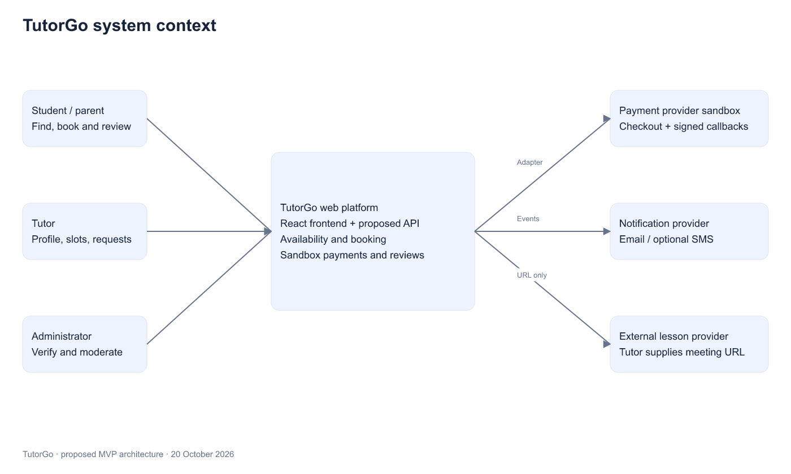
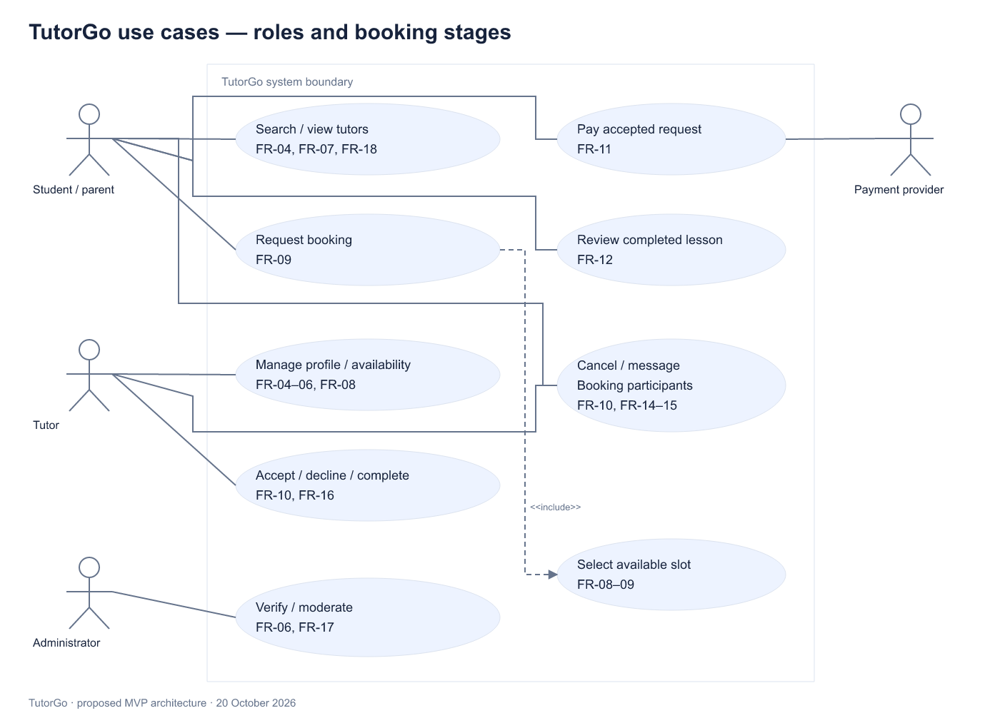
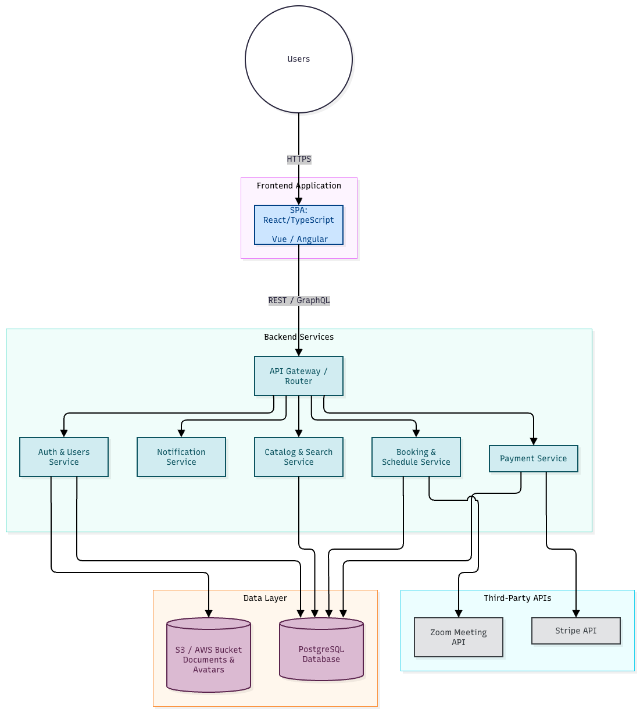

# 7. Architecture and diagrams

This is a proposed MVP design, not a description of a deployed backend. Context, use-case and component sources and exports were updated together on 20 October 2026. The existing ER diagram is retained as the initial model; required schema refinements are listed explicitly below.

## System context

[Editable draw.io source](../diagrams/System_Context_Diagram.drawio) and [SVG](../diagrams/exports/System_Context_Diagram.drawio.svg). Students/parents discover tutors, request slots, pay in sandbox and review completed lessons. Tutors manage profiles, availability and requests. Administrators verify documents and moderate. A payment adapter handles hosted checkout and callbacks; a notification adapter is optional. An external lesson URL is supplied by the tutor; TutorGo does not create video meetings through an API in the MVP.

## Use cases

[Editable source](../diagrams/Use_Case_Diagram.drawio) and [SVG](../diagrams/exports/Use_Case_Diagram.drawio.svg). The system boundary separates user roles from TutorGo actions. Request booking includes selecting an available slot. Paying an accepted request is a later action, not an unconditional payment at initial request creation. Reviews require a completed owned booking. Role/ownership authorization applies to each use case, not merely to navigation visibility.

## Component diagram

[Editable source](../diagrams/Component_Diagram.drawio) and [SVG](../diagrams/exports/Component_Diagram.drawio.svg). Proposed structure: React SPA → NestJS API boundary → modules within one backend process → PostgreSQL/private storage/provider adapters. The modular monolith avoids separate service deployment at this scale. Optional messaging stays participant-scoped; no transport has been implemented. Modules may access storage through repositories; guards and services enforce authorization. Provider callbacks terminate at a verified API endpoint before invoking payment state transitions.

## Data model

[Initial editable ER source](../diagrams/TutorGo.drawio) and [existing export](../diagrams/exports/TutorGo.drawio.png). Fourteen initial entities: users, tutor_profiles, tutor_documents, tutor_availability, tutor_time_off, subjects, tutor_subjects, favorites, bookings, payments, payouts, reviews, notifications and messages.

The initial ER is a design baseline, not an implemented schema. Before backend migration, refine it as follows:

| Entity / boundary | Required refinement | Reason |
|---|---|---|
| bookings | Add tutor_accepted_at, expires_at, client_request_key; unique student/request key; snapshot duration and price | Distinguish tutor acceptance from payment confirmation; expire holds and deduplicate requests |
| bookings | UTC timestamps; half-open tutor/time range; exclusion constraint for active pending/confirmed records | Prevent overlap in transactions while permitting adjacent lessons |
| payments | Provider event identifier and unique event receipt; amount/currency/booking validation; separate provider transaction uniqueness | Request retries and repeated callbacks are different deduplication boundaries |
| payouts | Link eligible booking/payment through a unique reference, or introduce an allocation table for aggregated payouts | Initial tutor-only payout relation cannot enforce one payout per booking |
| tutor_documents | Store object identifier, detected MIME/size, decision reason and review timestamp | Initial file URL alone does not provide safe private access or rejection traceability |
| users / auth | Revocable refresh-session records and deactivation checks | Stateless access tokens alone do not implement immediate refresh revocation |
| payment reconciliation | Record late/duplicate/conflicting events and refund state | Never silently revive a cancelled booking after payment |

Pending holds reserve slots until stored expiry. A transaction first releases expired holds, then inserts/reserves the requested interval under the database constraint; a background job performs eventual cleanup as well. Business logic still enforces guards under a row lock/transaction at the moment of mutation. A UI availability response alone cannot guarantee a later slot is free.

## Traceability

| Requirements | Component | Data | Screen / verification |
|---|---|---|---|
| FR-01–03 | Auth and users | users, planned sessions | T-01–03, S-01–02 |
| FR-04–06 | Profiles and verification | tutor_profiles, tutor_documents, subjects, tutor_subjects | Profile/admin mockups, T-04–06 |
| FR-07, FR-18 | Catalog and search | profiles, subjects, availability | Search/mobile mockups, T-07, T-18 |
| FR-08 | Availability | tutor_availability, tutor_time_off, bookings | Profile/tutor mockups, T-08 |
| FR-09–10 | Booking | bookings and planned lifecycle fields | Profile/tutor mockups, T-09–10, P-02 |
| FR-11 | Payment adapter and booking orchestration | payments, event receipts, bookings | Checkout mockup, T-11, P-02 |
| FR-12 | Reviews | reviews, completed bookings | T-12 |
| FR-13 | Profiles | favorites | T-13 |
| FR-14–15 | Messaging/events | messages, notifications | T-14–15 |
| FR-16 | Payout records | payouts and planned allocation reference | Tutor mockup, T-16 |
| FR-17 | Admin | users, documents, reviews | Admin mockup, T-17 |
| FR-19 | Optional ranking | Derived catalog features | T-19 |

See [requirements and state table](06-requirements.md), [scenario catalogue](../tests/README.md), [prototype index](../prototype/README.md) and [ADR](adr/0001-technology-stack.md). Matching the design does not imply the application has been built or tested.
