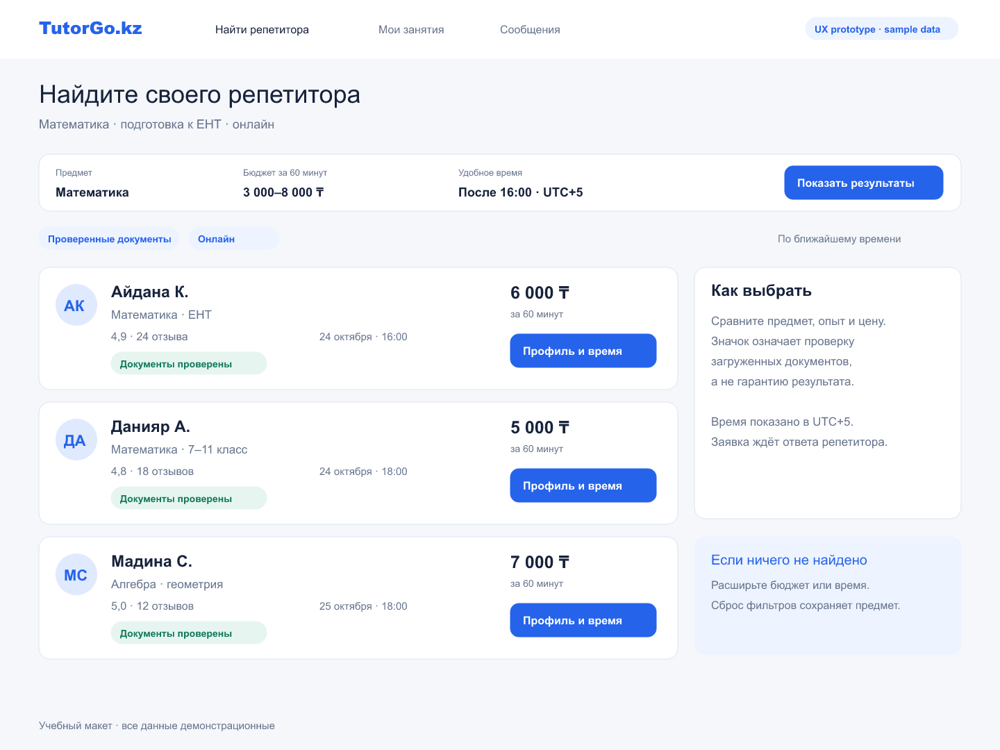
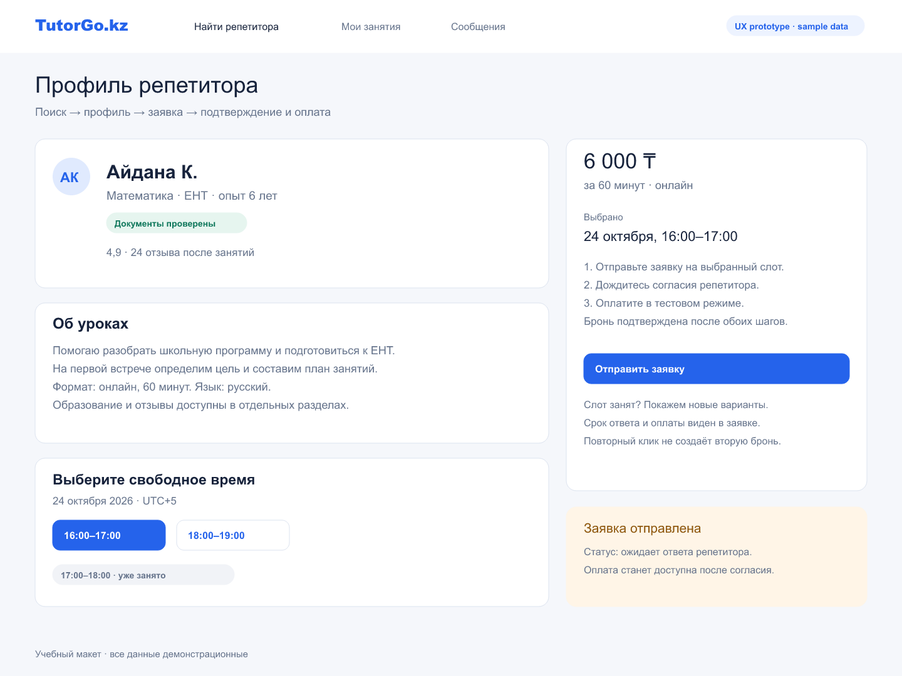
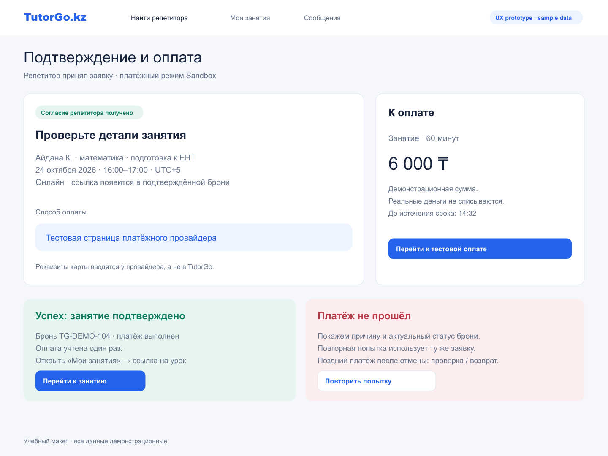
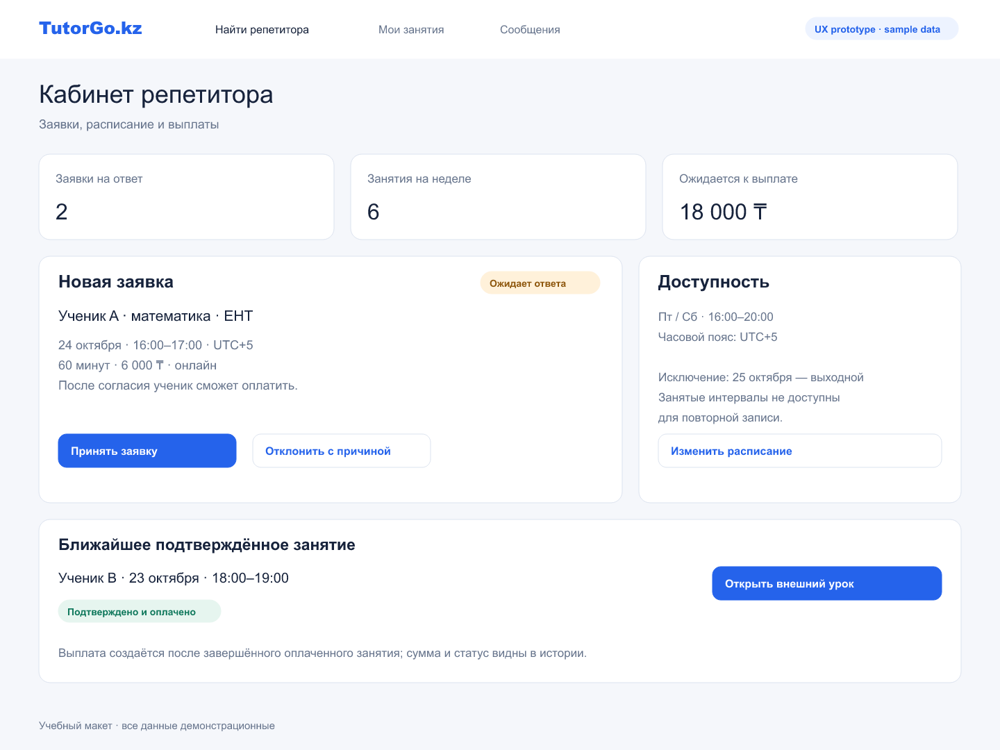
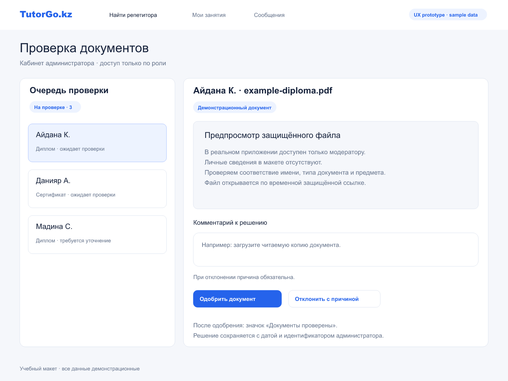

# 8. UX prototype

The repository contains a runnable landing page in [tutor-platform](../tutor-platform/) and six static design screens in [prototype](../prototype/README.md). The landing's search, authentication and booking controls are still placeholders. The new mockups specify future behaviour and are not evidence of an implemented backend.

## Key scenarios

| Scenario | Artifact | Requirements / states |
|---|---|---|
| Search and compare | [Search](../prototype/01-search-results.png) | FR-07; price, subject, availability, verification and no-results guidance |
| Profile and request | [Profile](../prototype/02-tutor-profile-booking.png) | FR-04, FR-08–10; free/taken slots and pending tutor response |
| Checkout | [Payment](../prototype/03-checkout.png) | FR-11; accepted request, sandbox payment, success, failure and late-payment handling |
| Tutor management | [Dashboard](../prototype/04-tutor-dashboard.png) | FR-08, FR-10, FR-16; acceptance, exceptions, confirmed lessons and payout information |
| Admin verification | [Verification](../prototype/05-admin-verification.png) | FR-06, FR-17; protected preview, approval and rejection reason |
| Mobile search | [390 px design](../prototype/06-mobile-search.png) | NFR-06; single-column reference; 360 px implementation still to be tested |

Editable SVGs, the walkthrough, accessibility expectations and rebuild instructions are in the [prototype index](../prototype/README.md). All values and identities are sample data. No user evaluation has been conducted.
